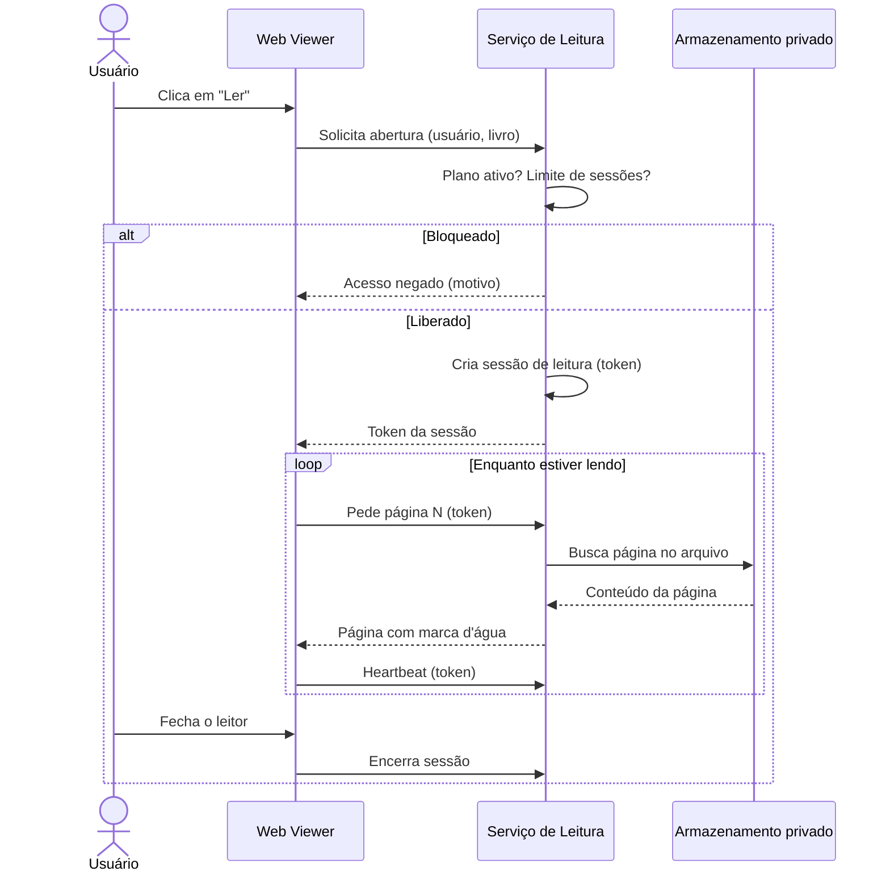
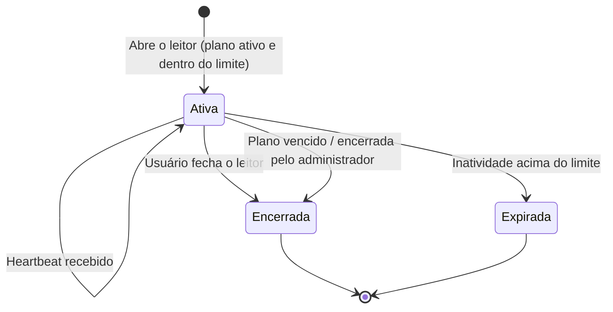
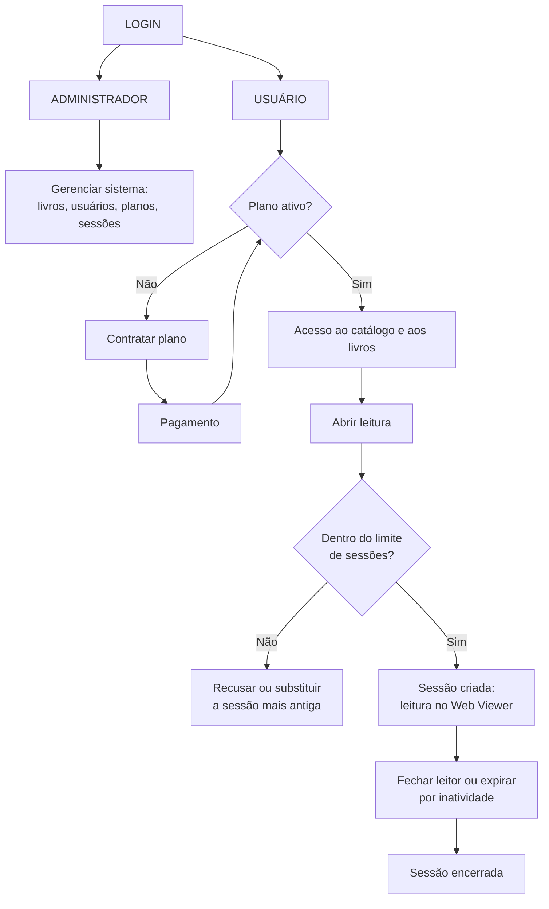

# 📚 Biblioteca Virtual


Sistema de **Biblioteca Virtual 100% digital** desenvolvido como projeto acadêmico **A3** da disciplina de **Programação e Algoritmos com Java**, aplicando conceitos de programação orientada a objetos, estruturas de dados, persistência de informações e regras de negócio no gerenciamento de um acervo digital, com leitura protegida dentro da própria plataforma.

---

## 📑 Sumário

- [Visão geral do sistema](#-visão-geral-do-sistema)
- [Objetivos](#-objetivos)
- [Funcionalidades](#️-funcionalidades)
- [Regras de negócio](#-regras-de-negócio)
- [Sistema de planos](#-sistema-de-planos)
- [Catálogo de livros](#-catálogo-de-livros)
- [Leitura digital protegida](#-leitura-digital-protegida)
- [Controle de sessões de leitura](#-controle-de-sessões-de-leitura)
- [Painel administrativo](#️-painel-administrativo)
- [Banco de dados](#️-banco-de-dados)
- [Arquitetura](#-arquitetura)
- [Segurança](#-segurança)
- [Validações](#-validações)
- [Fluxo geral do sistema](#-fluxo-geral-do-sistema)
- [Tecnologias](#-tecnologias)
- [Requisitos](#-requisitos)
- [Estrutura do projeto](#-estrutura-prevista-do-projeto)
- [Como executar](#️-como-executar)
- [Fluxo de desenvolvimento (Git)](#-git-e-fluxo-de-desenvolvimento)
- [Próximos passos de desenvolvimento](#-próximos-passos-de-desenvolvimento)
- [Colaboradores](#-colaboradores)
- [Status do projeto](#-status-do-projeto)
- [Licença](#-licença)

---

## 📖 Visão geral do sistema

A Biblioteca Virtual é um sistema **100% digital** para gerenciamento de livros, usuários, planos de acesso e sessões de leitura. Usuários podem se cadastrar, contratar um plano de acesso, consultar o acervo e **ler as obras diretamente na plataforma**, por meio de um leitor web integrado (Web Viewer). Administradores gerenciam o catálogo, a base de usuários e os planos.


O projeto contempla dois perfis de utilização:

| Perfil | Descrição |
|---|---|
| 👤 **Usuário** | Consulta o catálogo, contrata planos e lê livros no leitor integrado |
| 🛠️ **Administrador** | Gerencia livros, usuários, planos e sessões de leitura |

---

## 🎯 Objetivos

**Objetivo geral:** desenvolver um sistema de biblioteca digital em **Java**, aplicando os conhecimentos da disciplina de Programação e Algoritmos.

**Objetivos específicos:**

- Aplicar programação orientada a objetos na modelagem do sistema;
- Implementar cadastro de usuários e catálogo de livros digitais;
- Controlar planos de acesso, sua validade e contratação;
- Implementar um leitor integrado que impeça o download dos arquivos;
- Controlar sessões de leitura e acessos simultâneos;
- Implementar área administrativa;
- Aplicar validações cadastrais e boas práticas de desenvolvimento;
- Utilizar Git e GitHub em fluxo de trabalho colaborativo.

---

## ⚙️ Funcionalidades

### 👤 Área do usuário

- Criar conta e realizar login;
- Consultar e pesquisar o catálogo de livros;
- Visualizar detalhes e disponibilidade de um livro;
- Escolher, contratar e acompanhar o status/validade de um plano;
- Ler livros no leitor integrado (Web Viewer);
- Visualizar e encerrar suas sessões de leitura ativas;
- Favoritar livros e retomar a leitura de onde parou.

---

## 📜 Regras de negócio

As regras abaixo definem o comportamento esperado do sistema. Cada regra recebe um código (`RN`) para facilitar a rastreabilidade com os requisitos e os testes.

### Acesso e planos

| ID | Regra |
|---|---|
| RN01 | Somente usuários autenticados com **plano ativo** podem abrir um livro para leitura. |
| RN02 | Plano **expirado** bloqueia a abertura de novas leituras; sessões em andamento são encerradas no vencimento. |
| RN03 | O catálogo (busca e detalhes) pode ser consultado sem plano ativo, mas o conteúdo do livro não. |

### Leitura exclusivamente dentro da plataforma

| ID | Regra |
|---|---|
| RN04 | Os livros são lidos **exclusivamente** dentro da plataforma, por meio do leitor web integrado (Web Viewer). |
| RN05 | É **proibido o download** dos arquivos originais (PDF/ePub). O sistema não oferece botão, link ou rota de download. |
| RN06 | Os arquivos originais ficam em **armazenamento privado**, fora de qualquer pasta pública do servidor. |
| RN07 | O conteúdo é entregue ao leitor **por partes** (página ou capítulo) e somente mediante sessão válida. |
| RN08 | Cada página exibida carrega uma **marca d'água** com a identificação do usuário, para dissuadir a divulgação. |

> ⚠️ **Limite honesto da proteção:** nenhum sistema web consegue impedir 100% capturas de tela ou fotos da tela. O objetivo do DRM neste projeto é **impedir o download do arquivo pela aplicação** e **dificultar/dissuadir a cópia**, não garantir inviolabilidade. 

### Sessões de leitura e acesso simultâneo

| ID | Regra |
|---|---|
| RN09 | Toda leitura acontece dentro de uma **sessão de leitura**, com início, última atividade e fim. |
| RN10 | Cada conta possui um **limite de sessões simultâneas** (valor padrão sugerido: **2**, configurável por plano). |
| RN11 | Ao atingir o limite, uma nova sessão é **recusada** ou, por escolha do usuário, **substitui a mais antiga**. |
| RN12 | Sessões sem atividade por determinado tempo (sugestão: **15 minutos**) expiram automaticamente. |
| RN13 | O leitor envia sinais periódicos de atividade (*heartbeat*) para manter a sessão viva. |
| RN14 | O administrador pode **consultar e encerrar** sessões de qualquer usuário. |

### Conceitos removidos (modelo físico)

Os itens abaixo **não fazem mais parte** do projeto: empréstimo físico, prazo e data de devolução, controle de estoque de exemplares, cálculo de multa por atraso.

---

## 💳 Sistema de planos

Cada usuário pode possuir um plano de acesso associado à conta. O sistema verifica automaticamente se o plano está:

- ✅ **Ativo**
- ⚠️ **Próximo do vencimento**
- ❌ **Expirado**

```text
Usuário → Plano → Data de início → Data de vencimento → Plano válido?
                                                              ├── Sim → Acesso permitido
                                                              └── Não → Acesso bloqueado
```

O acesso a funcionalidades restritas (leitura de livros) depende do estado atual do plano.

### 💰 Contratação do plano

Durante a contratação, o sistema poderá solicitar dados de validação cadastral e pagamento (CPF, CEP, dados de pagamento).

> ⚠️ **Segurança:** o sistema não armazena dados completos de cartão de crédito no banco de dados. Em uma implementação real, o pagamento seria processado por um gateway especializado (com tokenização); para fins acadêmicos, poderão ser usados dados fictícios/simulados.

---

## 📚 Catálogo de livros

| Campo | Descrição |
|---|---|
| ID | Identificador único |
| Título | Nome do livro |
| Autor | Autor da obra |
| ISBN | Identificação do livro |
| Categoria | Categoria/gênero |
| Ano | Ano de publicação |
| Editora | Editora responsável |
| Arquivo | Referência ao arquivo em armazenamento privado (nunca exposta ao usuário) |
| Disponibilidade | Publicado (visível para leitura) ou despublicado |

Como o acervo é digital, **não há estoque de exemplares**: um mesmo livro pode ser lido por vários usuários ao mesmo tempo. O catálogo permite pesquisa e consulta das obras disponíveis.

---

## 🔒 Leitura digital protegida

O usuário nunca recebe o arquivo do livro. Ele recebe apenas o conteúdo renderizado, parte por parte, enquanto sua sessão for válida.



**Medidas de proteção previstas:**

- Sem rota, botão ou link de download de PDF/ePub;
- Arquivos fora de pastas públicas, acessados apenas pelo servidor;
- Entrega página a página, com token de sessão de curta duração;
- Marca d'água com identificação do usuário em cada página;
- Bloqueio de impressão e de seleção/cópia de texto no leitor (medida de dissuasão).

---

## 🔁 Controle de sessões de leitura

Uma **sessão de leitura** representa o uso de um livro por um usuário em um dispositivo, do momento em que abre o leitor até fechá-lo ou expirar.



O sistema conta apenas sessões no estado **Ativa** para verificar o limite de acessos simultâneos da conta.

---

## 🛠️ Painel administrativo

O administrador gerencia:

- **Livros:** cadastrar, alterar, remover, consultar e enviar o arquivo digital;
- **Usuários:** cadastrar, alterar e consultar;
- **Planos:** gerenciar, consultar ativos e expirados;
- **Sessões de leitura:** consultar sessões ativas e encerrá-las, quando necessário;
- **Acervo:** publicar e despublicar livros.

```text
Administrador → Autenticação → Painel Administrativo
                                    ├── Usuários
                                    ├── Livros
                                    ├── Planos
                                    └── Sessões de leitura
```

---

## 🗄️ Banco de dados

Estrutura conceitual prevista:

```text
USUARIO ──── PLANO
        ├─── PAGAMENTO
        └─── SESSAO_LEITURA ──── LIVRO

ADMINISTRADOR ──── GERENCIAMENTO
```

**Entidades previstas:** `Usuario`, `Administrador`, `Livro`, `Plano`, `Pagamento`, `SessaoLeitura`.

| Entidade | Responsabilidade |
|---|---|
| `Usuario` | Dados cadastrais, credenciais (hash de senha) e plano atual |
| `Administrador` | Perfil com permissões de gerenciamento |
| `Livro` | Metadados do livro e referência ao arquivo privado |
| `Plano` | Tipo, duração, valor e limite de sessões simultâneas |
| `Pagamento` | Registro simulado da contratação |
| `SessaoLeitura` | Usuário, livro, token, início, última atividade, fim e estado |

> As entidades `Emprestimo` e `Multa` foram **removidas** do modelo. A estrutura definitiva será refinada durante o desenvolvimento.

---

## 🧱 Arquitetura

O projeto é desenvolvido em **Java**, com conceitos de **Programação Orientada a Objetos**: classes, encapsulamento, herança, polimorfismo, abstração, interfaces, collections, tratamento de exceções, validação de dados e separação de responsabilidades em camadas.

```text
src/
├── model/
│   ├── Usuario.java
│   ├── Administrador.java
│   ├── Livro.java
│   ├── Plano.java
│   └── SessaoLeitura.java
├── service/
│   ├── UsuarioService.java
│   ├── LivroService.java
│   ├── PlanoService.java
│   └── LeituraService.java
├── repository/
│   ├── UsuarioRepository.java
│   ├── LivroRepository.java
│   ├── PlanoRepository.java
│   └── SessaoLeituraRepository.java
└── Main.java
```

---

## 🔐 Segurança


- **Dados pessoais:** informações como CPF são tratadas como dados sensíveis e usadas apenas quando necessárias às regras do sistema;
- **Senhas:** nunca armazenadas em texto puro — o correto é utilizar uma função de hash apropriada;
- **Pagamentos:** dados completos de cartão não são armazenados pela aplicação;
- **Conteúdo protegido:** arquivos originais ficam em armazenamento privado e só são lidos pelo servidor, nunca expostos por URL direta;
- **Tokens de sessão:** de curta duração, vinculados ao usuário e invalidados no encerramento ou expiração da sessão.

```text
Correto:   Aplicação → Gateway de pagamento → Processador de pagamento
Incorreto: Aplicação → Banco de dados → Número completo do cartão

Correto:   Leitor → Serviço de leitura (valida sessão) → Página renderizada
Incorreto: Leitor → URL pública do PDF → Arquivo completo baixado
```

---

## 🧪 Validações

- CPF e CEP em formato válido;
- Campos obrigatórios preenchidos e e-mail válido;
- Senha com requisitos mínimos de segurança;
- Existência de usuário, livro e plano consultados;
- Plano válido ou expirado;
- Livro publicado e com arquivo digital associado;
- Sessão de leitura existente, ativa e pertencente ao usuário;
- Limite de sessões simultâneas respeitado;
- Token de sessão válido e não expirado.

---

## 🔄 Fluxo geral do sistema



---

## 🚀 Tecnologias

- **Java**
- **Git** e **GitHub**
- **HTML e CSS** (protótipo da interface web em `src/`)
- **Banco de dados / SQL**, caso utilizado na implementação
- **IDE compatível com Java**

Tecnologias adicionais poderão ser incluídas conforme a arquitetura definitiva do sistema (por exemplo, uma biblioteca para renderizar páginas de PDF no servidor).

---

## 📋 Requisitos

### Funcionais

| ID | Requisito | Descrição |
|---|---|---|
| RF01 | Cadastro de usuário | O sistema deve permitir o cadastro de novos usuários |
| RF02 | Autenticação | Usuários autenticados acessam suas funcionalidades |
| RF03 | Cadastro de livros | O administrador pode cadastrar novos livros e enviar o arquivo digital |
| RF04 | Gerenciamento de livros | O administrador pode consultar, alterar, publicar e remover livros |
| RF05 | Consulta de livros | O usuário pode consultar o catálogo |
| RF06 | Gerenciamento de planos | O sistema permite contratação e controle de planos |
| RF07 | Validação do plano | O sistema verifica a validade antes de operações restritas |
| RF08 | Leitura integrada | O usuário lê o livro exclusivamente no leitor web da plataforma |
| RF09 | Bloqueio de download | O sistema não disponibiliza download dos arquivos PDF/ePub |
| RF10 | Sessão de leitura | O sistema cria, mantém (heartbeat), expira e encerra sessões de leitura |
| RF11 | Acesso simultâneo | O sistema limita o número de sessões ativas por conta |
| RF12 | Área administrativa | Funcionalidades exclusivas para administradores, incluindo consulta e encerramento de sessões |
| RF13 | Pagamento | Fluxo de contratação com dados fictícios ou gateway apropriado |

### Não funcionais

| ID | Requisito | Descrição |
|---|---|---|
| RNF01 | Linguagem | Desenvolvido em **Java** |
| RNF02 | Segurança | Informações sensíveis não armazenadas de forma insegura |
| RNF03 | Persistência | Dados importantes mantidos após o encerramento da aplicação |
| RNF04 | Usabilidade | Fluxos simples e compreensíveis |
| RNF05 | Manutenibilidade | Código organizado para facilitar futuras alterações |
| RNF06 | Versionamento | Desenvolvimento com **Git** e **GitHub** |
| RNF07 | Proteção de conteúdo | Arquivos originais em armazenamento privado, entregues por partes e com marca d'água |
| RNF08 | Desempenho de leitura | A página solicitada deve ser exibida em tempo aceitável (meta a definir com a equipe) |
| RNF09 | Concorrência | O controle de sessões deve funcionar corretamente com vários acessos ao mesmo tempo |

---

## 📂 Estrutura prevista do projeto

```text
BibliotecaVirtual/
├── src/
│   ├── model/
│   ├── service/
│   ├── repository/
│   ├── controller/
│   ├── index.html        (protótipo da interface)
│   ├── style.css         (estilos do protótipo)
│   └── Main.java
├── database/
│   └── schema.sql
├── docs/
│   ├── requisitos.md
│   └── diagramas/
├── testes/
├── .gitignore
├── LICENSE
├── README.md
└── pom.xml
```

> A estrutura poderá ser adaptada conforme as ferramentas e decisões técnicas da equipe.

---

## ▶️ Como executar

**Pré-requisitos:** Java JDK, Git, banco de dados configurado (se utilizado) e uma IDE compatível com Java.

```bash
# Verificar instalação do Java
java --version

# Clonar o repositório
git clone URL_DO_REPOSITORIO

# Entrar no diretório do projeto
cd BibliotecaVirtual
```

A forma de execução final dependerá da estrutura do projeto e da ferramenta de build utilizada.

---

## 🌿 Git e fluxo de desenvolvimento

Desenvolvimento colaborativo via GitHub, com branches de funcionalidade integradas à branch principal:

```text
main
 ├── feature/cadastro-usuarios
 ├── feature/catalogo-livros
 ├── feature/planos
 ├── feature/leitor-digital
 ├── feature/sessoes-leitura
 └── feature/painel-admin
```

---

## 🧭 Próximos passos de desenvolvimento

1. **Modelagem:** desenhar o diagrama de classes (`Usuario`, `Livro`, `Plano`, `SessaoLeitura`) e definir os estados da sessão.
2. **Decisões em aberto (a definir em equipe):**
   - Limite padrão de sessões simultâneas (sugestão: 2) e se ele varia por plano;
   - Tempo de inatividade para expirar a sessão (sugestão: 15 min);
   - Política ao atingir o limite: recusar a nova sessão ou substituir a mais antiga;
   - Formatos suportados na primeira versão (sugestão: começar apenas com PDF).
3. **Banco de dados:** criar o `schema.sql` com as tabelas já sem `Emprestimo` e `Multa`.
4. **Base do sistema:** cadastro de usuários, autenticação e catálogo de livros.
5. **Planos:** contratação simulada e validação de vencimento.
6. **Leitura protegida:** serviço que entrega páginas por sessão, com marca d'água e sem rota de download.
7. **Sessões:** criação, heartbeat, expiração e limite de acessos simultâneos.
8. **Painel administrativo:** gestão de livros, usuários, planos e sessões.
9. **Testes e defesa:** testes automatizados das regras `RN01` a `RN14` e preparação da apresentação.

---

## 👥 Colaboradores

| Colaborador | GitHub |
|---|---|
| Davi Peres | [@Davi-trainer](https://github.com/Davi-trainer) |
| Melissa | [@melissasn](https://github.com/melissasn) |
| Hillo Silva | [@HilloSilvaDev](https://github.com/HilloSilvaDev) |
| Euriandes Jales | [@EuriandesJales](https://github.com/EuriandesJales) |

---

## 🎓 Projeto acadêmico

Desenvolvido como parte da avaliação **A3** da disciplina **Programação e Algoritmos com Java**, aplicando em um projeto prático conceitos de programação, modelagem, lógica, orientação a objetos, persistência de dados e desenvolvimento colaborativo.

---

## 📈 Status do projeto

🚧 **Em desenvolvimento**

- [x] definição das regras de negócio
- [ ] Estrutura inicial do projeto
- [ ] Modelagem das entidades
- [ ] Banco de dados
- [ ] Cadastro de usuários e autenticação
- [ ] Cadastro de livros e catálogo
- [ ] Sistema de planos e validação
- [ ] Sistema de pagamento
- [ ] Leitor digital protegido (Web Viewer)
- [ ] Controle de sessões de leitura e acessos simultâneos
- [ ] Painel administrativo
- [ ] Testes
- [ ] Documentação
- [ ] Apresentação final

---

## 📜 Licença

Este projeto está licenciado sob a **MIT License**. Consulte o arquivo [`LICENSE`](LICENSE) para o texto completo.

> Software desenvolvido exclusivamente para fins **acadêmicos e educacionais**, como parte do projeto A3 da disciplina de Programação e Algoritmos com Java.

---

<p align="center">
  Desenvolvido por <strong>Davi Peres · Melissa · Hillo Silva · Euriandes Jales</strong>
</p>

<p align="center">
  📚 Biblioteca Virtual — Projeto A3
</p>